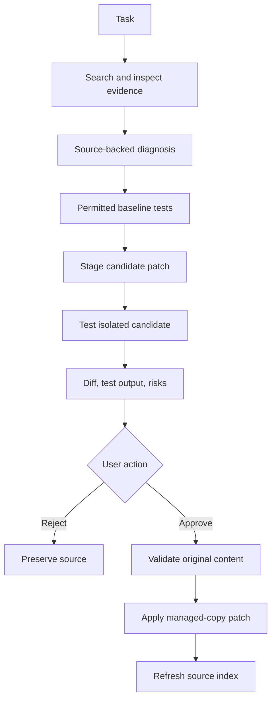

# Agent workflow and approval

An agent chooses actions, uses explicit tools and observes their structured
outputs. RepoPilot keeps this mode separate from repository Q&A because test
execution and source proposals have different permissions and failure modes.
It stores public action summaries, not private chain-of-thought.

## Tools and execution boundaries

| Tool family | Problem solved | Validation and output |
| --- | --- | --- |
| Search code | Find candidate evidence | Bounded query/results with paths, symbols and lines |
| Read file | Inspect concrete source | Repository-scoped relative path; bounded content |
| Find symbol/references | Locate named definitions and textual uses | Validated identifier/query; evidence ranges, approximate references |
| Dependencies | Inspect possible impact | Known indexed file/symbol; conservative graph output |
| Run tests/command | Observe a regression | Test allowlist only; Docker result, exit code, duration, executed flag |
| Create patch/diff | Prepare reviewable changes | Allowed path, exact before/after, original hash and unified diff |

The command interface is deliberately narrow. `pytest`, `python -m pytest` and
restricted `npm test` forms are supported. Shell operators, arbitrary Python,
unsafe paths and unsupported flags are rejected before Docker execution. A
permitted command can still run malicious test code, which is why command
validation complements the sandbox rather than replacing it.

Each step persists tool name, arguments, structured result, duration, success
and a summary such as “Inspecting checkout source” or “Running candidate tests.”
Steps/timeouts bound runaway work; failed tools return errors that remain visible.
Long runs execute through the job backend and the UI polls persisted state.

## Offline behavior and provider boundary

The offline workflow investigates indexed evidence and recognizes the bundled
missing-quantity checkout regression. It proposes the source-supported change
from `item['quantity']` to `item.get('quantity', 1)`. General investigations may
finish with findings and limitations instead of a patch. This is a constrained
debugging demonstration, not a claim of unrestricted autonomous development.

Configured generation can assist a bounded planner and source proposal, while
tool validators, path checks, command allowlists and human approval remain outside
model control. A tool-call schema gives a model a structure to request an action;
the server still decides whether the arguments are valid and the action is
allowed. Repository text cannot grant new capabilities.

Alternatives are a fixed diagnostic script, a general tool-calling model, a
workflow engine or an IDE agent. The constrained workflow is reproducible and
explainable, but handles fewer bugs. Richer model planning needs stronger test
coverage, action budgets, cancellation, retry behavior and audit records before
expanding permissions.

## Patch lifecycle

Proposals store affected paths, full before/after text, original content hashes,
explanation, risks and a unified diff. Candidate tests use a temporary copy;
the managed repository remains unchanged while status is awaiting approval.
Unavailable Docker execution records no exit-code success and no claim of a
passing baseline/candidate suite.

Approve validates source against the proposal's original content. If source
changed since the proposal, a conflict is safer than applying an outdated edit.
Approval writes only the staged managed-copy changes and refreshes its index.
Reject transitions the run and preserves source. The original GitHub remote and
the bundled demo are not pushed or silently edited.

Human approval is necessary because a patch can pass narrow tests while breaking
uncovered behavior. Review the diff, evidence, test output and untested risks.
Production work would additionally use a branch/commit, CI, code review and a
transactional release mechanism.

## Sandbox behavior

The Docker runner copies regular source files, excluding symlinks, `.git`,
dependency directories and common credential files. It mounts that snapshot
read-only and copies source into a writable temporary workspace inside a
resource-limited container. The root filesystem remains read-only, network is
disabled and secrets from the API environment are not forwarded.

Python commands use `SANDBOX_IMAGE`; npm commands use `SANDBOX_NODE_IMAGE`.
The supplied Python image includes pytest. The default Node image provides
Node/npm; projects needing Jest or other packages need a locally built image
with those dependencies available. The runner neither installs packages nor
pulls images during execution. Image tools/dependencies must live outside the
temporary `/workspace` mount and be exposed through image configuration, such
as its executable search path.

Output includes `status`, `executed`, `success`, `exit_code`, command and duration.
`unavailable` means tests did not execute. Timeout or truncated output also remains
visible. Cleanup removes temporary source and the named container. Docker
isolation shares the host kernel; a dedicated runner or microVM boundary is the
scaling/security path. See [security](security.md).

## Scaling the agent

Separate agent and indexing queues so a slow test does not block ingestion.
Use per-repository locks around approval/reindexing, durable leases and idempotent
steps; track costs and cancellation. Route execution to a dedicated runner with
no application credentials. Store large logs as bounded artifacts and keep only
metadata in PostgreSQL. The MVP does not claim all of these operational features.
