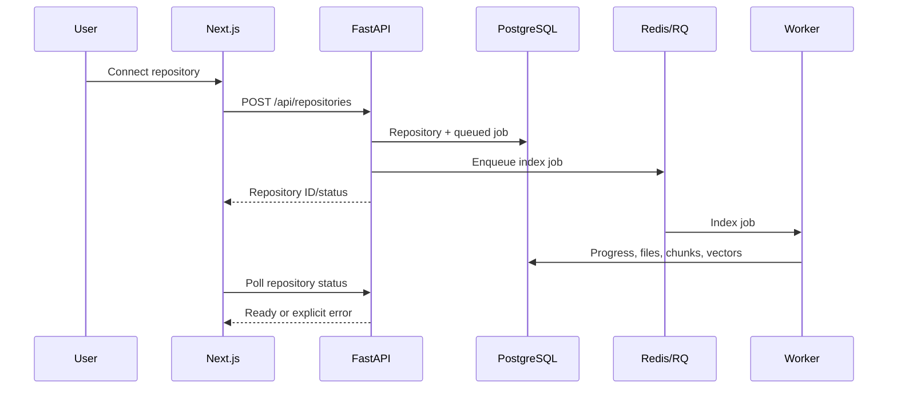

# Architecture

RepoPilot separates source ingestion, retrieval, answer generation and agent
execution. The goal is an inspectable local product: a developer can connect
source, ask questions, open evidence, inspect relationships and review a proposed
patch. It is not a production multi-tenant hosting service.

## Request and job boundaries

The Next.js workspace calls relative `/api` URLs. A server-only runtime proxy
forwards them to FastAPI and can inject a configured shared API token. FastAPI
validates Pydantic request models and stores state using SQLAlchemy sessions.
Long operations create persisted job/run records before dispatching work.

The API assigns a UUID request ID, accepting a client ID only when it has the
canonical UUID form. HTTP responses and structured HTTP/query logs share that
ID, including admission rejections. The Next proxy forwards validated UUID
headers in both directions, so browser requests can be correlated with backend
query timings without logging questions, authorization headers or credentials.

The PostgreSQL deployment runs an RQ worker process. Redis also provides an
optional query-response cache keyed by repository index generation, provider,
question and retrieval strategy, with a TTL. In local mode an in-process
executor runs jobs; it provides the same visible states but not durable recovery
after a process crash. [RQ's own documentation](https://python-rq.org/) explains
the Redis-backed job model.

Queue and worker use JSON serialization for primitive job identifiers/arguments.
Linux uses the standard RQ worker; Windows selects SpawnWorker so execution does
not depend on `fork()`. [RQ's worker documentation](https://python-rq.org/docs/workers/#spawnworker)
describes that platform choice. Redis remains a trusted execution-control service
and must not be exposed to untrusted writers.

## Ingestion and persistence

Public GitHub HTTPS URLs, bounded ZIP files and the bundled demo enter a managed
directory. Validation, file filtering and parsing occur without running the
repository's code. Python/JavaScript/TypeScript grammars extract symbols, imports
and source ranges. Chunks prefer functions/classes/modules and retain metadata
when splitting a large symbol, within both 100-line and 6,000-byte UTF-8 limits.
Vectors and lexical inputs are stored beside the
source metadata. Ingestion also persists per-repository JSON lexical statistics
bound to the index generation and chunk IDs. Queries reuse those statistics
through a bounded memory cache, rather than tokenizing the whole corpus each
time; missing/stale artifacts rebuild from indexed chunks. The dependency graph
uses conservative file imports.

Admission budgets cap ZIP/downloads at 25 MiB, expanded repository source at
64 MiB, a file at 512 KiB, indexed files at 2,000 and chunks at 10,000. A source
line that cannot fit into the UTF-8 chunk budget causes that file to be skipped;
repository indexing notices expose this coverage loss. Selected answer source
context is bounded to 30,000 characters including accounted path/symbol text.

Progress is persisted as queued → cloning → parsing → embedding → indexing →
ready. Failure records an error; a failed import must not be treated as ready.
Reindexing refreshes the evidence used for subsequent queries.

| Entity | Responsibility |
| --- | --- |
| User | Schema scaffold for future ownership; no implemented account/login service |
| Repository | Source identity, optional owner, managed root, language/count summary, index status |
| RepositoryFile | Indexed relative path, content, size/language metadata |
| CodeChunk | Symbol, type, line range, content and embedding |
| Conversation / Message | Repository-linked query history and cited answers |
| IndexingJob | Persisted stage, progress and errors |
| AgentRun / AgentStep | Task lifecycle, public tool trace, patch and tests |
| EvaluationDataset | Named question/file/symbol/keyword cases |
| EvaluationRun | Executed strategy metrics and per-case results |

UUID identifiers avoid collisions between locally created records. Foreign keys
tie evidence/runs to a repository, indexes support repository-scoped access, and
timestamps describe lifecycle events. Alembic manages schema creation rather
than relying on developers to manually create tables. No functioning user/tenant
permission model is claimed; introduce ownership and authorization before
multi-user deployment.

PostgreSQL uses pgvector for native vectors; the extension can support exact or
approximate nearest-neighbor search. The PostgreSQL migration configures a cosine
HNSW index; a small corpus may still be scanned directly by the query planner.
This path needs integration measurement on PostgreSQL, and ANN tuning needs
comparison against exact recall. [pgvector documentation](https://github.com/pgvector/pgvector)
describes the operators and recall/speed tradeoffs. SQLite stores JSON vectors
and computes similarity locally; it is a development fallback, not a substitute
for production database concurrency.

## Component decisions

| Component | Problem and mechanism | Why chosen / alternative | Tradeoff and scaling path |
| --- | --- | --- | --- |
| Next.js + TypeScript | Typed navigation, chat, code and graph UI; server API proxy | Common frontend stack; alternative Vite SPA | Server/build complexity; stateless replicas behind proxy |
| Tailwind | Consistent spacing, theme and responsive layout through utilities | Small design surface; alternative component library | Style discipline required; shared tokens/components reduce drift |
| FastAPI + Pydantic | HTTP endpoints, validated schemas, generated OpenAPI | Python AI ecosystem; alternative Django/NestJS | CPU-heavy work must leave request path; scale stateless API replicas |
| SQLAlchemy | Explicit data entities and transactions across PostgreSQL/SQLite | Backend portability; alternative direct SQL | ORM overhead; inspect SQL and prevent N+1 queries |
| Alembic | Versioned schema changes applied at startup/setup | Repeatable development; alternative manual migrations | Concurrent deploy migration coordination; apply once per release |
| PostgreSQL + pgvector | Store source metadata and searchable vectors together | Fewer operational services; alternative Qdrant/OpenSearch | Vector workloads share DB resources; index/partition then separate when measured |
| Redis | Broker and short-lived answer cache | Existing queue/cache service; alternative RabbitMQ or DB jobs | Cache misses and outages must be handled; isolate queue/cache policies at scale |
| RQ worker | Moves indexing/agent/evaluation out of HTTP calls | Simple Python execution; alternative Celery/Temporal | Limited orchestration; add durable retries, leases, cancellation and queue separation |
| Tree-sitter | Syntax trees across Python/JS/TS without importing code | Multi-language ranges; alternative Python AST/Babel | Parsing is not type checking; add language resolvers and incremental commits |
| Provider interfaces | Swap embeddings/generation/reranking independently | Supports offline demo and hosted inference | Model drift and compatibility; record provider generations and reindex |
| Docker sandbox | Run permitted tests away from API process | Familiar process isolation; alternative microVM runner | Shares host kernel; move daemon to dedicated runner and consider microVMs |

## Dependency analysis

Nodes are files and edges are resolved imports. Outgoing edges answer “what does
this file import?” Incoming edges and reverse traversal answer “which files may
depend on this file?” `shop/routes.py` imports `shop/auth.py` and
`shop/checkout.py` in the demo, so authentication changes may affect routes.

Ask Repo recognizes impact/dependency questions and resolves an explicit full
path, unique basename or unique symbol to an indexed file. It traces reverse
imports, adds bounded target/dependent source chunks to answer context and
prepends an import-chain summary with source citations. An unresolved or
ambiguous target returns a request for a unique name. The response includes
`impact` metadata and measures this stage as `graph_ms`; graph evidence uses the
same context budget as ordinary retrieval.

This analysis is deliberately conservative. It does not claim complete call
graphs, type resolution, runtime reflection, framework routing or package alias
resolution. A future symbol graph can add call edges only when their resolution
is evidenced and confidence is exposed. Graph traversal finds candidates for
review; tests and language tooling are needed to establish actual effects.

## Operating modes and fallback decisions

| Original choice | Fallback | Reason | Cost |
| --- | --- | --- | --- |
| PostgreSQL/pgvector + Redis/RQ | SQLite + JSON vectors + local executor | Start on a laptop without Docker | Less concurrency, local retrieval and non-durable in-process jobs |
| Hosted neural embeddings | Normalized token feature hashes | No credentials/download needed | Lexical overlap rather than learned semantics |
| Hosted language generation | Extractive evidence summaries | Demonstrable grounded answers offline | Limited explanation and reasoning |
| Trained reranker | Symbol/identifier heuristic | No external model required | Cannot deeply compare semantic relevance |
| Docker execution | Explicit unavailable result | Missing daemon/image is common | Tests remain unverified; patches require human review |

## Scaling to 10,000 repositories

The current MVP has no evidence of that capacity. Before aiming at it, measure
chunks per repository, vector dimensions, index size, query distribution and
ingestion costs. Move managed sources to object storage, shard ingestion queues,
bound per-repository concurrency and budget provider calls. Persist a commit/index
generation so readers never mix old and new evidence. Use dedicated API and
worker pools, database connection pooling and repository-scoped vector filters.

Then tune the approximate index against exact Recall@K, add an external lexical
index if corpus scoring or artifact loading dominates latency, and cache derived
artifacts. Introduce authentication, tenant ownership, rate limits, quotas,
backups, worker leases and observability before inviting untrusted users. Split
the vector service only if resource contention or functionality justifies it.
